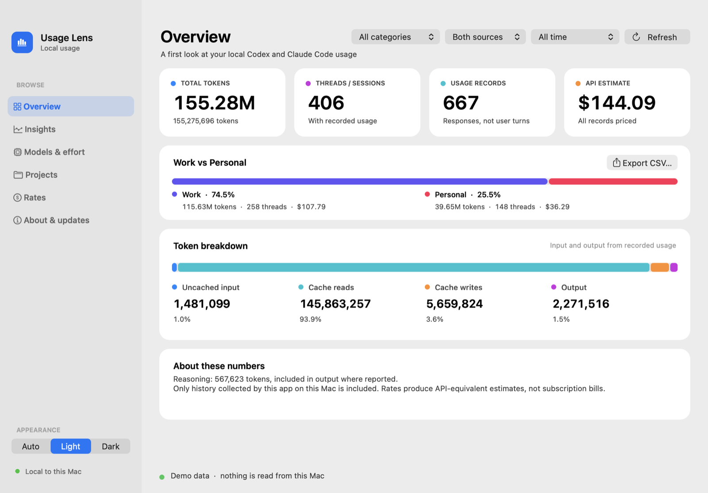

# Usage Lens

A private, native macOS app that shows how much you use **Codex** and **Claude Code**: tokens, sessions, models, projects and an API-equivalent cost estimate. Everything is computed on your Mac from the history files those tools already keep. There is no account, no analytics and no server.



## Features

- **Overview, Insights, Models and Projects** views with source, period and category filters.
- **Work and Personal categories.** Choose a default on first launch, then move individual projects to Personal. Reports and CSV export can be split or filtered by category.
- **API-equivalent estimates** from rates you enter yourself. They are comparisons, not invoices.
- **Light, dark or automatic** appearance.
- **Private by design.** See [PRIVACY.md](PRIVACY.md).

## Install

Download the zip for your Mac from the [latest release](../../releases/latest) (Apple Silicon or Intel), unzip it, and drag **Usage Lens** to Applications. Compare the file's SHA-256 with `SHA256SUMS.txt` on the release page:

```sh
shasum -a 256 Usage-Lens-macOS-arm64.zip
```

The app is signed ad hoc and not notarized, so macOS asks you to confirm the first launch. Open **System Settings → Privacy & Security**, scroll down and choose **Open Anyway** (on older macOS: right-click the app and choose Open). Building from source, below, avoids this.

Requires macOS 12 or later.

## Build from source

Install the Xcode Command Line Tools and a current stable [Rust](https://rustup.rs) toolchain, then:

```sh
cargo test --locked
./build-app.sh
open "dist/Usage Lens.app"
```

To try the app without any real history, run it with demo data:

```sh
"dist/Usage Lens.app/Contents/MacOS/usage-lens-mac" --demo
```

## What it reads

Only `.jsonl` history files under `~/.codex/sessions`, `~/.codex/archived_sessions` and `~/.claude/projects`. It stores counters and metadata (not prompts or responses) in `~/Library/Application Support/Usage Lens Mac/`, plus your rates and category choices. Project names are the last folder name recorded in the history.

## How the numbers work

- A *usage record* is one accounting event (Codex) or one distinct response (Claude); a Claude response is not necessarily a user turn.
- Claude snapshots with the same session, response and request IDs are deduplicated, keeping the most complete snapshot. Zero-token records are omitted.
- For Codex, cache reads and writes are subtracted from the reported input total to give uncached input. Structured per-response usage takes precedence over cumulative snapshots; conflicting turns are flagged.
- Reasoning tokens are shown separately and are not added to output again.
- Time filters are rolling periods from now; rows without timestamps appear only in All time.
- Only history files that still exist can be read.

## Updates and feedback

Open **About & updates** in the app. *Check for updates* makes a single HTTPS request to the project's download page and sends only the app version; automatic checks are off by default. *Send feedback* opens a pre-filled GitHub issue in your browser. Please do not paste prompts, code or private project names into issues.

## Uninstall

Quit the app and move it to the Trash. To remove its data as well, delete `~/Library/Application Support/Usage Lens Mac/`. Your Codex and Claude history files are never modified.

## Contributing

See [CONTRIBUTING.md](CONTRIBUTING.md). Releases are described in [RELEASING.md](RELEASING.md).

## License

[MIT](LICENSE). Usage Lens is an independent project and is not affiliated with or endorsed by OpenAI or Anthropic; Codex and Claude are trademarks of their respective owners.
